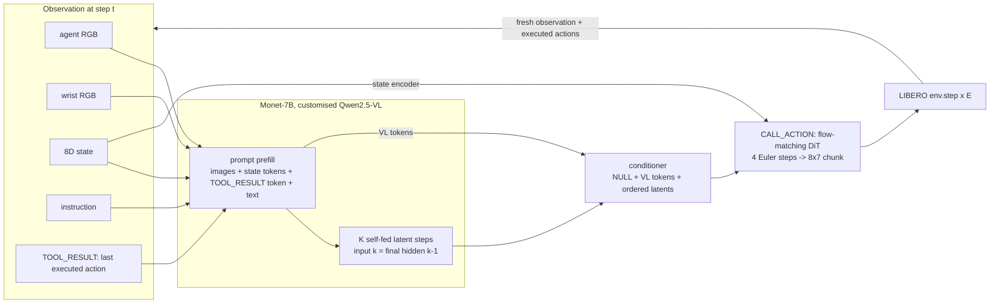
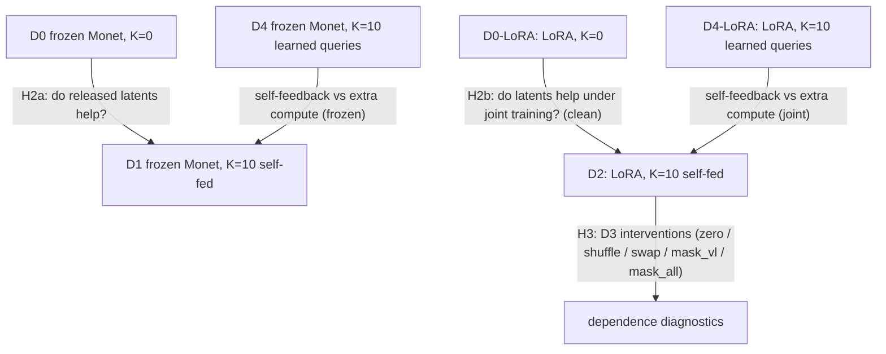
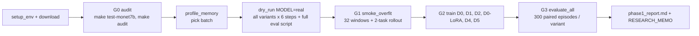

# Monet-Action Phase 1: the big picture

## 1. What we are testing

**Question.** Do Monet-7B's self-fed continuous latent steps improve closed-loop robot manipulation when
they condition a learned flow-matching action expert, compared with matched models that lack those steps?
**And is it worth the cost?**

Everything else in the repository (prompting, DiT, data, simulator, logging, statistics) exists so that this
one comparison is fair, measurable and reproducible.

## 2. The experiment: which comparison answers which question

| contrast | isolates | status |
|---|---|---|
| D1 vs D0 | the value of released (frozen) Monet latents; K is the only difference | primary |
| D2 vs **D0-LoRA** | latent recurrence under joint training; LoRA, budget and data are identical | primary (**added in this review**) |
| D2 vs D0 | as written in the proposal, but **confounded**: LoRA adaptation of the VL features also differs | reported, labelled confounded |
| D1 vs D4, D2 vs D4-LoRA | self-feedback vs matched extra token passes | secondary (D4-LoRA optional) |
| K sweep 0/5/10/20 | dose-response and latency cost | exploratory |
| latents-only, no-TOOL_RESULT action, SFT latent layout | design ablations | exploratory |
| D3 on D2 | dependence on latent content (OOD perturbations) | diagnostic |
| K=10 vs K=0 at each Monet adaptation level: frozen, LoRA (D2), wide LoRA, full FT of 4 / 8 layers | whether the latent benefit depends on how much of Monet is trained (is D2's small LoRA the limit?) | exploratory, pre-registered decision rule ([FINETUNING.md](FINETUNING.md)) |

The full proposal, its hypotheses and a requirement-by-requirement traceability table are in
[PROPOSAL.md](PROPOSAL.md).

## 3. Pipeline and gates

**Pass criteria before starting the long G2 runs (all on the GPU server):**

1. `make test-monet7b` is green. That means:
   * no missing weights;
   * finite latents of shape `[2,10,3584]`;
   * parity with the authors' code at relative error < 5e-2 and cosine > 0.998;
   * state dependence, and LoRA gradients on every LoRA tensor.
2. `make audit` writes `results/audit/g0_report_monet7b.json`. Check that the image correlation with the
   dataset is > 0.8 and that the simulator steps.
3. `scripts/profile_memory.sh configs/d2_lora.yaml`. Pick the largest micro-batch with peak memory
   ≤ ~80 GB, then set `train.batch_size` and `train.grad_accum` so the effective batch stays 16, or scale
   the learning rate deliberately.
4. `MODEL=real bash scripts/dry_run.sh` prints `DRY RUN OK`. This executes every training variant,
   in-training simulator evaluation, checkpoint and warm-start chaining, every evaluation mode,
   interventions and the report.
5. `scripts/smoke_overfit.sh`: the fixed-noise `overfit_log.jsonl` falls steadily, and the two-task
   rollout runs without convention errors. Watch the videos: the arm should move towards the bowl, not
   away or upside down.

## 4. Does the proposal make sense? Assessment and changes

**What is sound:**

* Matched variants that share the same DiT, data, split, seeds and budget.
* The D4 compute control.
* Perturbation diagnostics, with their OOD caveat.
* Cost reporting.
* Pre-registered statistics.
* Refusing placeholder latents, and requiring parity with the authors' code.

**Issues and what was done:**

1. **Information argument.**
   * The latents are a deterministic function of the same prompt whose VL tokens the DiT already sees.
     They cannot add *information*, only *computation and representation*.
   * With frozen Monet (D1), any gain must come from features the recurrence computes and the DiT cannot
     easily compute itself. D1 ≈ D0 is therefore a plausible, informative outcome.
   * Gains are most plausible when the action loss can shape the recurrence (D2). That makes the D2
     contrast central.
2. **The proposal's D2 vs D0 comparison is confounded.** D2 adds both LoRA and latents.
   → **Added `D0-LoRA`** (and optional `D4-LoRA`), with the same LoRA, stage-B budget and warm-start
   structure.
3. **Out-of-distribution use of the latents.**
   * Monet emits `<abs_vis_token>` mid-reasoning, after text. Here it is forced right after the prompt.
   * The released checkpoint was RL-trained with the inference latent layout at K=10; SFT used another
     layout at K=8.
   → The default is now the RL/inference layout, the SFT layout is an ablation, and
   `make test-monet7b` measures how much the two differ.
4. **Statistical power.**
   * With 300 paired episodes per variant (Monte Carlo, exact McNemar, α=0.05, latent correlation 0.5),
     power for a true gain is:

     | gain | baseline 60% | baseline 80% | baseline 90% |
     |---|---|---|---|
     | +3 pp | 0.13 | 0.18 | 0.27 |
     | +5 pp | 0.31 | 0.42 | 0.70 |
     | +8 pp | 0.67 | 0.87 | 1.00 |

   * Gains below ~8 pp will often be inconclusive. Report CIs, not just p-values.
   * If D1 − D0 looks small but positive, add episodes: more seeds over the same states, or a second
     training seed.
5. **One training seed.** Variant differences can sit inside training-seed variance.
   * If effects are small, retrain the principal variants with
     `--override train.seed=1 train.output_dir=runs/<name>_s1`.
6. **Ceiling risk.** Strong VLAs reach ~95–98% on LIBERO-Spatial. If D0 already lands above ~93%, the
   suite cannot show a reasoning benefit. Next steps would be:
   * a low-data regime (`--override data.max_episodes_per_task=10`), which also tests the proposal's
     "sample efficiency" claim;
   * or harder suites (`eval.suite=libero_goal` / `libero_10` with matching data).
7. **Train/eval image mismatch (found in this review).** The training PNGs carry JPEG 8×8 artefacts;
   clean simulator renders do not. → Evaluation now applies a JPEG round-trip (`eval.jpeg_quality=90`,
   measured match). A test guards it.
8. **TOOL_RESULT action history** can cause behaviour-cloning copycat behaviour. → It is hidden for 30%
   of training samples (`tool_result.dropout`), and `d1_no_toolresult` measures the effect.
9. **Cost realism.**
   * Monet-7B + K=10 at every control step (E=1) is a simulator protocol, not a deployable rate.
   * The cost-quality frontier should include E=2 (in `evaluate_all.sh`) and optionally
     `--execution-prefix 4`.

## 5. Readiness: what is verified where

| component | CPU container (done) | GPU server (to do, in order of §3) |
|---|---|---|
| Monet latent recurrence | parity with the authors' code at ~1e-6 on the tiny config, both layouts, cached = recompute, gradients | `make test-monet7b` |
| tokenizer / prompt layout | real Monet-7B tokenizer, K ∈ {0,5,10,20}, both layouts | — |
| DiT / flow matching / masks | unit tests + tiny overfit (monotone) | smoke overfit with Monet-7B |
| data | real LeRobot shards: conventions, split, windows, previous actions | full download |
| simulator | resets, orientation, demo replay success, JPEG matching, closed loop | EGL rendering (`make test-sim`) |
| training loop | resume, warm-start chaining (D1→D2, D0→D0-LoRA), gradient audit, in-training sim eval | memory profile; `MODEL=real` dry run |
| evaluation | all modes + interventions + report via `MODEL=tiny dry_run.sh` | full protocol |
| monitoring | status / events / system / logs, dashboard, bundles | — |

## 6. Compute budget (estimates; replace with measured numbers)

| stage | runs | estimate on one ~96 GB Blackwell |
|---|---|---|
| G0 + dry run + smoke | — | ~2–3 h |
| G2 core training | D0, D1, D4, D5 at 20k steps; D2 and D0-LoRA at 10k | ~1–1.5 s/step → ~6–8 h per 20k-step run → ~1.5–2 days |
| G3 evaluation | ~25 closed-loop evaluations (variants, E=2, D3, solver steps) | ~40–60 min each at E=1 → ~1 day |
| extras (`EXTRA=1`) | K sweep, ablations, D4-LoRA | +1–1.5 days |

## 7. After the results: how to read them

* **D1 > D0 and D1 > D4.** Released self-fed latents carry action-useful computation: a strong
  Phase 1 claim.
* **D1 ≈ D0, D2 > D0-LoRA and D2 > D4-LoRA.** Latents help only when shaped by the action loss.
  Phase 2 (perception tokens before reasoning) is justified.
* **D2 ≈ D0-LoRA.** No evidence for latent reasoning in control at this scale. Report it as a negative
  result.
  * Check D3 first: if interventions do not hurt D2, the head bypasses the latents
    (`mask_vl` vs `mask_all` tells which tokens it uses).
  * Phase 2 should then be reconsidered.
* **Any gain that disappears at E=2 or costs more than ~2× GPU-s per success** should be reported on
  the cost-quality frontier, not as a win.
