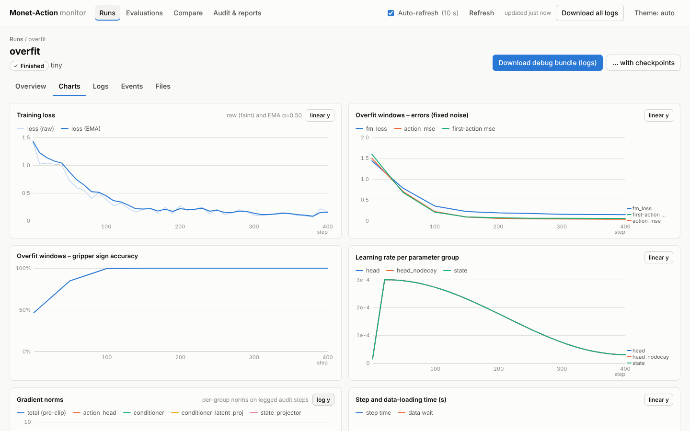
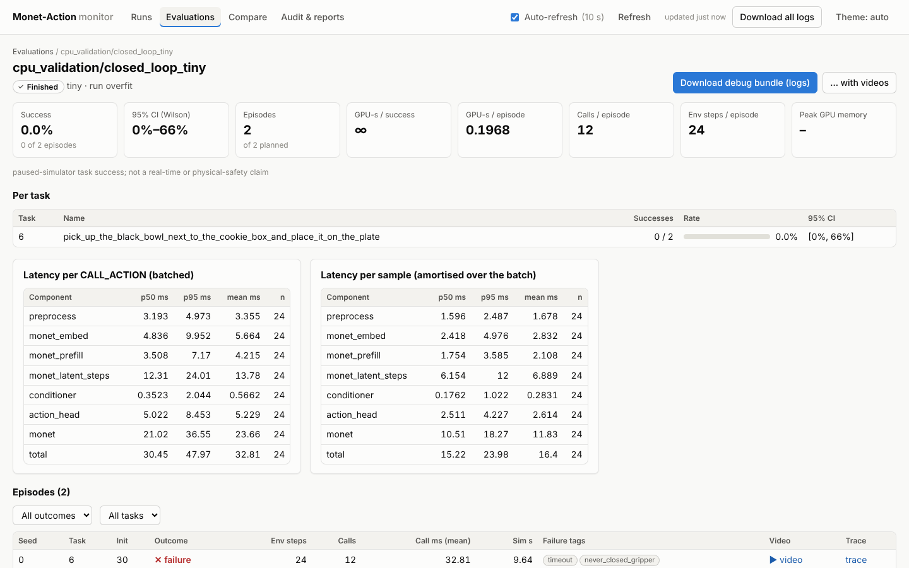

# Monitoring dashboard and debug bundles

A small, dependency-free web dashboard for watching Monet-Action training runs and evaluations, plus a
`bundle` tool that zips a run's logs for later debugging. It only **reads** the files that training and
evaluation write. You can run it next to a live job on the GPU server, from a laptop through an SSH tunnel,
or later on an unzipped debug bundle.

* Server: Python standard library only (`http.server`, `json`, `zipfile`). It does not import torch.
* UI: one static page (vanilla JS + CSS) with no CDN or external requests, so it works on offline servers.
* Code:
  * `src/monet_action/dashboard/` (server + `static/`)
  * `src/monet_action/bundle.py`
  * `scripts/dashboard.sh`
  * tests in `tests/test_dashboard.py`

Screenshots, taken from the tiny CPU validation run in this repository:




## Quick start

```bash
bash scripts/dashboard.sh                 # serves runs/ and results/ on http://localhost:8765
```

From your laptop, tunnel to the GPU server and open http://localhost:8765:

```bash
ssh -L 8765:localhost:8765 <user>@<gpu-server>
```

Options (`python -m monet_action.dashboard --help`):

| flag | default | meaning |
|---|---|---|
| `--runs` | `runs` | root that holds training run directories |
| `--results` | `results` | root that holds evaluations, audit reports and `phase1_report.md` |
| `--host` | `127.0.0.1` | bind address. Keep the default and use the SSH tunnel |
| `--port` | `8765` | |
| `--token` | `$MONET_DASHBOARD_TOKEN` | require this token on every request (see Security) |
| `--refresh` | `10` | UI auto-refresh period in seconds; the UI has an on/off toggle |
| `--verbose` / `--quiet` | errors only | request logging: every request / nothing |

## What you see

* **Runs.** One row per run directory, showing:
  * state badge (running, stale, finished, failed, stopped, starting, unknown);
  * progress (`step / max_steps`), last loss, ETA, time since the last update;
  * K, LoRA, head type, reasoning mode, feature source;
  * a per-run `logs.zip` link.

  A run whose `status.json` says *running* but has not been updated for 10 minutes is shown as **stale**,
  which usually means the process died. A `*` marks a state inferred from the log files of an older run
  without `status.json`.
* **Run → Overview.**
  * status with the error text of a failed run;
  * the key configuration (variant, K, convention, recurrence, feedback gradient, LoRA, feature source,
    batch, learning rates, …) and the full `config.json`;
  * parameter counts and the gradient audit;
  * memory profile, representation (latent/VL layer, pooling, token layout, example prompt),
    environment, data split;
  * checkpoints, with download links.
* **Run → Charts.** Charts are drawn in the browser. Hover or use the arrow keys for exact values; each
  chart has a linear/log y toggle. They cover:
  * training loss (raw + EMA);
  * held-out and overfit-window `fm_loss`, `action_mse` and first-action MSE (fixed noise);
  * gripper sign accuracy;
  * periodic simulator success;
  * learning rate per parameter group;
  * gradient norms (total pre-clip + per group);
  * step and data-wait time;
  * peak torch memory;
  * GPU utilisation and memory per GPU, host CPU and RAM.

  Missing files are listed instead of drawing empty charts.
* **Run → Logs.**
  * tail of `logs/*.log` and other `*.log`/`*.txt`/`*.out`/`*.err` files (200–20,000 lines);
  * case-insensitive filter with highlighting, or a server-side search over the last 8 MB;
  * "follow tail";
  * tracebacks, errors, NaN and OOM lines are marked;
  * full-log download.
* **Run → Events.** `events.jsonl` (start, resume, checkpoint, val, sim_eval, finished, failed, …), newest
  first.
* **Run → Files.** Every file in the run directory with size and age, plus open and download links, and
  the bundle buttons.
* **Evaluations.** One row per evaluation directory, showing:
  * success with Wilson 95% CI;
  * GPU-seconds per success and per episode;
  * CALL_ACTION p50/p95 latency (total, Monet, action head);
  * execution prefix and Euler steps;
  * progress of a running evaluation.

  The detail page adds:
  * per-task success;
  * latency per call and amortised per sample;
  * an episode table (filter by outcome and task) with failure tags, video and trace links;
  * a video gallery;
  * `offline.json` / `latency.json`, the eval log and `eval_config.json`.
* **Compare.** Overlays the training-loss EMA, held-out `fm_loss` and `action_mse`, overfit and
  simulator-success curves of up to 8 runs. A run keeps its colour while others are added or removed. It
  also lists the evaluations linked to those runs, through `eval_config.json → model_config.train.output_dir`.
* **Audit & reports.** `results/audit/*` and the top-level `results/*.md|json|txt` files (e.g.
  `phase1_report.md`), shown as text, pretty-printed JSON or images.

## File contract (what producers must write)

Paths are relative to a run directory `runs/<name>/` (any sub-directory of `--runs`, up to 3 levels deep,
that contains `config.json` or `status.json`).

| file | written by | content |
|---|---|---|
| `config.json` | train | `ExperimentConfig.to_dict()` |
| `status.json` | train | `{"kind":"train","name","variant","state":"starting\|running\|finished\|failed\|stopped","pid","host","started_at","updated_at","step","max_steps","samples","eta_s","last_loss","error","output_dir"}`. Times are unix seconds; refresh `updated_at` at least every few minutes while running |
| `train_log.jsonl` | train | one line per logged step: `{"step","loss","fm_loss" or "mse_loss","grad_norm","lr_scale","lrs":{group:lr},"step_time_s","data_time_s","peak_mem_gb","samples","time","grad_groups": null \| {group:{"grad_norm","finite","n_tensors","n_tensors_nonzero_grad"}}}`. Event lines (`{"event":"resume",...}`, no `loss`) are allowed and are skipped by the charts |
| `val_log.jsonl`, `overfit_log.jsonl` | train | `{"step","fm_loss","action_mse","action_mse_first","gripper_acc","val_batches","time"}` |
| `sim_eval_log.jsonl` | train (optional) | `{"step","success_rate","n_episodes","per_task":{task_id:{"successes","trials"}},"time"}` |
| `system.jsonl` | train / eval | `{"time","gpus":[{"index","name","util_percent","mem_used_gb","mem_total_gb","temp_c","power_w"}],"cpu_percent","ram_used_gb","ram_total_gb","disk_free_gb","torch_mem_allocated_gb","torch_max_mem_allocated_gb"}` (any field may be `null`) |
| `events.jsonl` | train / eval | `{"time","event", ...extra}` |
| `logs/*.log` | train / eval | plain text |
| `param_report.json`, `gradient_audit.json`, `memory_profile.json`, `environment.json`, `normalizer.json`, `split.json`, `representation.json` | train | as written by `train.py` |
| `ckpt_XXXXXXX/{trainable.pt,optimizer.pt,rng.pt,meta.json}`, `last` | train | checkpoints and the pointer to the latest one |

An evaluation directory is any sub-directory of `--results/eval`, plus any directory under `--results`
(up to 4 levels deep) that contains `summary.json` or `episodes.jsonl`. It may contain:

* `eval_config.json`;
* `episodes.jsonl` (`{"task_id","init_state_idx","seed","success","env_steps","action_calls","sim_time_ms","call_latency_ms":[{component:ms}],"batch_sizes":[int],"wall_s","failure_tags":[str]}`);
* `summary.json` (`metrics.aggregate_episodes` + extra keys);
* `traces/seed{S}_task{T}_init{I}.jsonl` and `videos/seed{S}_task{T}_init{I}_{success|failure}.mp4`;
* `status.json` (`{"kind":"eval",...,"episodes_done","episodes_total"}`);
* `logs/eval.log`, `system.jsonl`, `offline.json`, `latency.json`.

Rules the reader relies on:

* JSONL files are **append-only**: write one complete line, ending in a newline, per record.
* A line without its trailing newline (still being written) is not shown until it is complete.
* Malformed lines are skipped.
* A file that is replaced or truncated is re-read from the start.
* `NaN` / `Infinity` written by Python's `json` are fine. The server converts them to strict JSON:
  `null`, or the strings `"Infinity"` / `"-Infinity"`.

## HTTP API (JSON)

| endpoint | returns |
|---|---|
| `GET /api/config` | version, refresh period, roots, `token_required`, stale threshold |
| `GET /api/runs` | `{runs:[run summary]}` |
| `GET /api/run/<name>` | summary, status, config, key_config, param_report, gradient_audit, memory_profile, representation, environment, split (counts), checkpoints, logs, series availability, files |
| `GET /api/run/<name>/series?file=train_log\|val_log\|overfit_log\|sim_eval_log\|system\|events&since=<line>` | `{rows, next, total, file_id, reset, downsampled}`. Pass the returned `next` as `since` to fetch only new lines (at most 2,000 points per response; the first and latest rows are always kept). If `file_id` changes or `reset` is true, start again from `since=0` |
| `GET /api/run/<name>/log?file=logs/train.log&tail=N[&q=text]` | the last N lines (`q` searches the last 8 MB) and the list of available logs |
| `GET /api/evals`, `GET /api/eval/<name>[/log]` | evaluation summaries; detail with per-episode rows, videos, offline/latency data |
| `GET /api/compare?runs=a,b` | per-run curves (downsampled) and linked evaluation summaries |
| `GET /api/audit` | `results/audit/*` and top-level report files |
| `GET /files/runs/<path>`, `GET /files/results/<path>[?download=1]` | raw files (range requests supported for video) |
| `GET /api/bundle/run/<name>?checkpoints=0\|1&videos=0\|1` | streamed zip of that run |
| `GET /api/bundle/eval/<name>?videos=0\|1` | streamed zip of that evaluation |
| `GET /api/bundle/all` | all runs + results (logs only: never checkpoints or videos) |

Names containing `/` (e.g. `eval/d1_k10`) are URL-encoded as one segment: `/api/eval/eval%2Fd1_k10`.

## Debug bundles

Use the buttons on the run and evaluation pages, "Download all logs" in the header, or the CLI:

```bash
python -m monet_action.bundle runs/d1_k10 results/eval/d1_k10 -o d1_debug.zip
```

```bash
python -m monet_action.bundle runs/d2_lora -o d2_full.zip --include-checkpoints --include-videos
```

* **Always included.** Text and log files (`.json .jsonl .md .txt .log .yaml .yml .csv .out .err`), the
  `last` pointer, each checkpoint's `meta.json`, and figures up to 10 MB.
* **Opt-in.** Checkpoint weights (`--include-checkpoints` / `checkpoints=1`) and rollout videos
  (`--include-videos` / `videos=1`).
* **Skipped.** Non-log files larger than `--max-file-mb` (200 MB) unless checkpoints are requested.
  Log-like files are never size-capped. Hidden or temporary entries (`.tmp_ckpt_*`) and symlinks that
  leave the directory are always skipped.
* **`bundle_manifest.json`.** Every bundle has one, recording:
  * creation time and host;
  * sources and options;
  * included files with sizes, and skipped files with the reason;
  * git commit, branch and dirty flag;
  * Python and platform, versions of key packages, the full installed-package list (pip-freeze
    equivalent);
  * `nvidia-smi` output;
  * a short allow-list of environment variables (never secrets).
* **Consistent snapshot.** Text files are copied in memory first, so a log that is still being written is
  captured consistently.

To inspect a bundle later, unzip it and point the dashboard at it:

```bash
unzip d1_debug.zip -d debug && python -m monet_action.dashboard --runs debug/runs --results debug/results
```

## Security

* **Binding.** The server binds `127.0.0.1` by default; use `ssh -L`. Binding another interface without
  a token prints a warning.
* **Token.** With `--token` (or `MONET_DASHBOARD_TOKEN`), every request needs the token. It can be sent
  as `?token=` on the first visit, as `X-Dashboard-Token: <token>`, or as `Authorization: Bearer <token>`.
  After the first authenticated request the browser gets an `HttpOnly; SameSite=Strict` session cookie,
  which holds an HMAC of the token, not the token itself.
* **File serving.** Files are served only from the two configured roots, after resolving `..`, encoded
  separators and symlinks; anything outside returns 403/404. Files under the roots are never served as
  HTML. File responses carry a `sandbox` Content-Security-Policy and `nosniff`.
* **Page hardening.** The page itself runs under a strict CSP: same-origin scripts and styles only, no
  inline script. All data is inserted as text, never as HTML.

## Troubleshooting

* **A run does not appear.** Its directory needs `config.json` or `status.json`. Discovery is cached for
  2 s, and symlinked sub-directories are not followed (symlink the whole `--runs` root instead).
* **Everything shows "stale".** The producer stopped refreshing `status.json` `updated_at`, or the
  server's clock differs from the writer's.
* **Port in use.** Pass `--port`.
* **Installing as a wheel.** The static files live in `src/monet_action/dashboard/static/`. Running from
  the repository (`PYTHONPATH=src` or `pip install -e`) needs nothing else. A non-editable wheel must ship
  them as package data:

  ```toml
  [tool.setuptools.package-data]
  "monet_action.dashboard" = ["static/*"]
  ```
